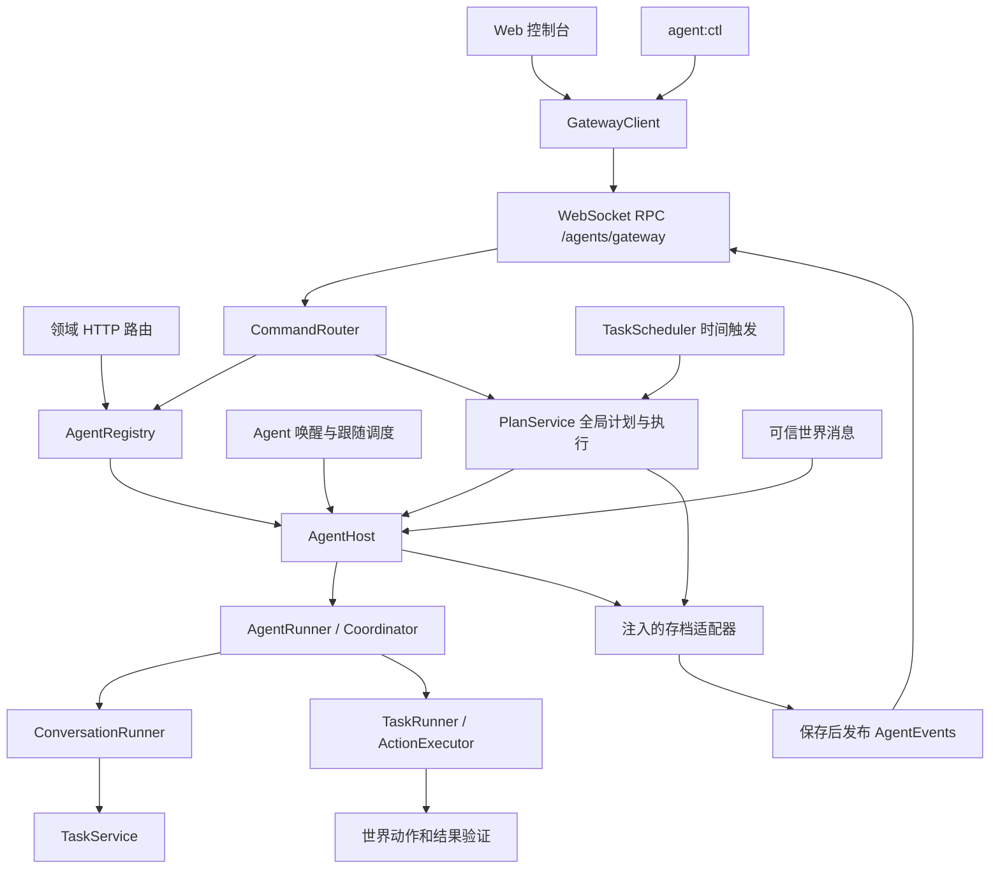

# Agent Gateway

Gateway 与世界服务使用同一进程和端口。管理连接位于 `/agents/gateway`，角色的 Colyseus 世界连接独立于管理连接。关闭控制台或 CLI watch 不会停止托管角色；`stop` 会让角色离开世界。



## 包边界

- `packages/gateway-protocol`：浏览器安全的 RPC v1 类型、公开视图和参数校验，仅依赖共享业务类型。
- `packages/gateway-client`：宿主注入 socket；处理握手、请求关联、超时、订阅序号、重连和未确认命令查询。不会自动重发写请求。
- `apps/server/src/modules/gateway`：令牌、RPC 命令分发与 socket 适配；HTTP 路由由各领域维护并在 app.ts 装配。
- `apps/server/src/modules/providers`：`provider-store.ts`（模型提供商配置持久化）、`provider-validation.ts`、`provider-port.ts`、`providers.routes.ts`。
- `apps/server/src/modules/tasks`：`model.ts`（TaskPlan 状态计算）、`service.ts`（计划与运行历史）、`scheduler.ts`（计划调度）、`port.ts`（任务领域接口与服务封装）、`routes.ts`（HTTP 路由）。
- `apps/server/src/modules/agent`：`orchestrator.ts`（Agent 核心编排调度器）、`manager.ts`（生产依赖注入）、`host.ts`（AgentHost 宿主执行器）、`storage.ts`（存档文件适配）、`routes.ts`（HTTP 路由）。各类校验与实体紧密内聚在各自领域模块中。
- `apps/server/src/modules/audio/tts/agent-speech.ts`：世界内语音合成队列、空间听众筛选与音频缓存，由 `WorldRoom` 装配并管理生命周期。

Gateway 按程序规则路由。消息意图仍由 ConversationRunner 判断；网关没有模型分类请求。每个角色的模型和动作串行，跨角色可并行，在线上限仍为 4。命令提交按角色排队；执行中的模型请求不占据提交队列。暂停、取消、离开、删除在通过前置校验后立即发出取消信号，再等待执行退出和状态保存。

世界消息队列容量 8，满时拒绝新消息并记录原因。快捷暂停/取消保留原玩家身份和私聊范围；成功后不再送入模型。连接代次与事件序号共同防止重复处理。普通聊天不恢复暂停、受阻或预算耗尽任务。

## 授权和配置

优先读取 `AGENT_GATEWAY_TOKEN`。未设置时读取 `AGENT_GATEWAY_TOKEN_FILE`，默认 `.data/agent-gateway-token`；不存在则随机生成，文件权限 `0600`。启动日志只显示来源或文件位置。令牌为 24–4096 个无空白字符。更换后重启服务生效。

浏览器 Origin 必须在 `AGENT_GATEWAY_ALLOWED_ORIGINS` 逗号分隔列表中，禁止 `*`。未设置时使用明确的 `WEB_ORIGIN`；若游戏配置为通配，则仅使用固定本机开发 Origin。Docker 默认允许 `http://localhost` 与 `http://127.0.0.1`，其他域名和端口需显式配置。无 Origin 的 CLI 仍需令牌。

Web 首次进入控制台输入令牌，按服务地址保存在当前标签页的 sessionStorage，可以清除；认证失败停止重连。每个控制台共享一个 socket，切换分类不会创建新管理连接。断线保留最后数据、禁用写操作，重连重新订阅快照。Agent/任务不再通过两秒轮询刷新。

HTTP `/agents`、`/providers`、`/tasks`、`/task-runs`、`/voice/tts/**` 与 `/voice/asr/services` 管理接口要求 `Authorization: Bearer <token>`。ASR/TTS 配置仍用 HTTP；实际音频和游戏通道保持原有玩家会话授权。全局资源已从 `/agents` 前缀迁出；前端与 HTTP 客户端须同步升级，业务参数和响应结构保持原样。

## RPC v1

JSON 文本帧，首帧：

```json
{ "type": "connect", "version": 1, "client": "web", "token": "<管理员令牌>" }
```

5 秒内未握手关闭连接；输入帧最多 32 KiB。服务端回复 `connected`，包含版本、进程级 `gatewayEpoch`、capabilities。请求格式：

```json
{ "type": "req", "id": "1", "method": "agents.list", "params": {} }
```

写请求另带稳定 `commandId`。响应 `type=res` 关联 `id`，用 `ok/result` 或 `ok=false/error` 表达结果。错误包含 code、status、message。成功表示必要业务记录已经保存，模型和世界动作是否完成需读取任务/执行状态。

| 方法                                                               | 参数概要                                                                                                                                  |
| ------------------------------------------------------------------ | ----------------------------------------------------------------------------------------------------------------------------------------- |
| gateway.status / subscribe / unsubscribe                           | 订阅 scope，可选 agentId、planId；取消订阅传 subscriptionId                                                                               |
| commands.get                                                       | commandId                                                                                                                                 |
| agents.list / get / create / update / join / stop / delete / voice | agentId、value；创建不要求 agentId                                                                                                        |
| tasks.assign / pause / resume / cancel                             | agentId、expectedTask、value                                                                                                              |
| plans.list / get / create / update / control / reassign            | list 支持 offset/search/state/timing/agentId；写入使用 planId、expectedPlanRevision，create 必须指定 agentId，reassign 指定 targetAgentId |
| runs.list / control                                                | list 使用 planId、offset；control 使用 runId、expectedTask 和 pause/resume/cancel，执行角色由记录定位                                     |
| providers.list / save / delete / models                            | providerId、value                                                                                                                         |

value 使用现有 HTTP 的业务对象。tasks.\*、runs.control，以及 plans.control 的 run 要求 expectedTask（无当前任务时为 null），来自角色快照的 taskIdentity，字段为 id/revision/startedAt。旧任务修订返回 409。计划编辑、暂停、启用、追加额度和改派使用 expectedPlanRevision，独立于聊天任务修订。HTTP 适配绑定当前状态，不增加旧请求必填字段；旧角色路径访问已改派计划返回 409。

RPC 公开快照带资源版本和任务身份，不公开模型密钥、原始 Pi 上下文和 runtime。订阅支持 all、agents、agent、plans、runs、providers。先注册变化监听再读取快照，快照期间的更新暂存；每个订阅从 seq=1 开始连续发送。变化只包含资源标识和版本，详情按需读取。发送积压超过 1 MiB 关闭连接并要求重新同步。

同 commandId、同业务内容的并发请求共享结果；不同内容冲突。进行中的记录不淘汰，已结束记录最多 1,024 条、保留 10 分钟。内部指纹使用摘要，不保留明文密钥。HTTP 校验可选 Idempotency-Key 的格式；该头不会自动提供 RPC 的命令去重语义。任务计划原有 requestId 持久去重继续有效。

连接丢失时写请求显示“结果待确认”；重连先查 commands.get 并重取快照。网关重启或记录过期返回 unknown，不能自动重发。此协议不保证所有写操作跨重启 exactly-once。

## CLI

```sh
pnpm agent:ctl auth show
pnpm agent:ctl list --json
pnpm agent:ctl status <agentId>
pnpm agent:ctl join <agentId>
pnpm agent:ctl stop <agentId>
pnpm agent:ctl task assign <agentId> --goal '到指定位置等待'
pnpm agent:ctl task pause <agentId>
pnpm agent:ctl task resume <agentId>
pnpm agent:ctl task cancel <agentId>
pnpm agent:ctl plans [agentId]
pnpm agent:ctl runs <agentId> <planId>
pnpm agent:ctl watch <agentId>
```

所有管理命令支持 `--url`、`--token-file`、`--json`。默认地址 `ws://127.0.0.1:2567/agents/gateway`。令牌从环境变量或文件读取，不提供明文 token 命令行选项。auth show 是显式读取本地令牌文件供用户配置页面；不要将输出复制到日志。watch 的 Ctrl+C 只断开客户端。旧 pnpm agent / agent:ai / agent:mock 仍独立运行，Ctrl+C 会退出其自身角色。

## 存档与部署

同一路径的存档升级为 Gateway v1 聚合对象：`{version:1, agents, plans, runs, requests}`。角色仅保存当前执行关联，计划与历史独立保存；runtime 仍为 v2。整个对象通过临时文件加原子替换一次提交，不存在第二份计划库。

首次加载旧角色数组前独占创建 `.before-task-plan-module-v1.bak`，已有备份不覆盖；备份、迁移或校验失败阻止升级写入。原计划/执行 ID、累计用量、检查点和按原角色作用域记录的 requestId 保留。纯聊天自动生成的计划转为无 planId 执行；混合或来源不明的历史保留，聊天执行不出现在计划历史。完成迁移和保存后才启动恢复与调度。

重启时未结束执行暂停，错过时间不补跑，未知动作不重放；私聊会话失效需重新通过聊天发起。消息队列和订阅不持久化。升级后的存档不能交给旧版写入；回滚必须先停服务，再恢复专用备份。现用服务备份、升级及重启是单独部署步骤。

存档失败会中断受影响 Agent 并停止其后续世界动作，命令不会返回提交成功；修复存储后重启。查询使用已提交快照。正常关闭停止接收写命令和调度，取消执行、等待退出、保存暂停状态、关闭连接；保留原上线意愿以便下次上线待命。

Nginx 代理覆盖 `/agents`、`/providers`、`/tasks`、`/task-runs`、`/voice`；`/agents/gateway` 保留 Upgrade；同一分发器区分 Gateway、实时 ASR 和 Colyseus。Dockerfile 已包含新增工作区依赖，未增加部署端口或容器。升级切换现用服务属于单独部署步骤。

## 验证入口

`pnpm check`、`pnpm test:gateway`、现有 Agent/任务/聊天/语音/导航集成；`pnpm test:integration` 已改为随机端口、临时存档的 CLI 协议测试。Gateway 单元测试覆盖去重、按角色串行、边界校验、授权、快照空窗、慢连接、客户端重连和保存失败。浏览器、真实模型及 Docker 证据分别记录在 VALIDATION.md；fixture 通过不代替真实模型验收。
