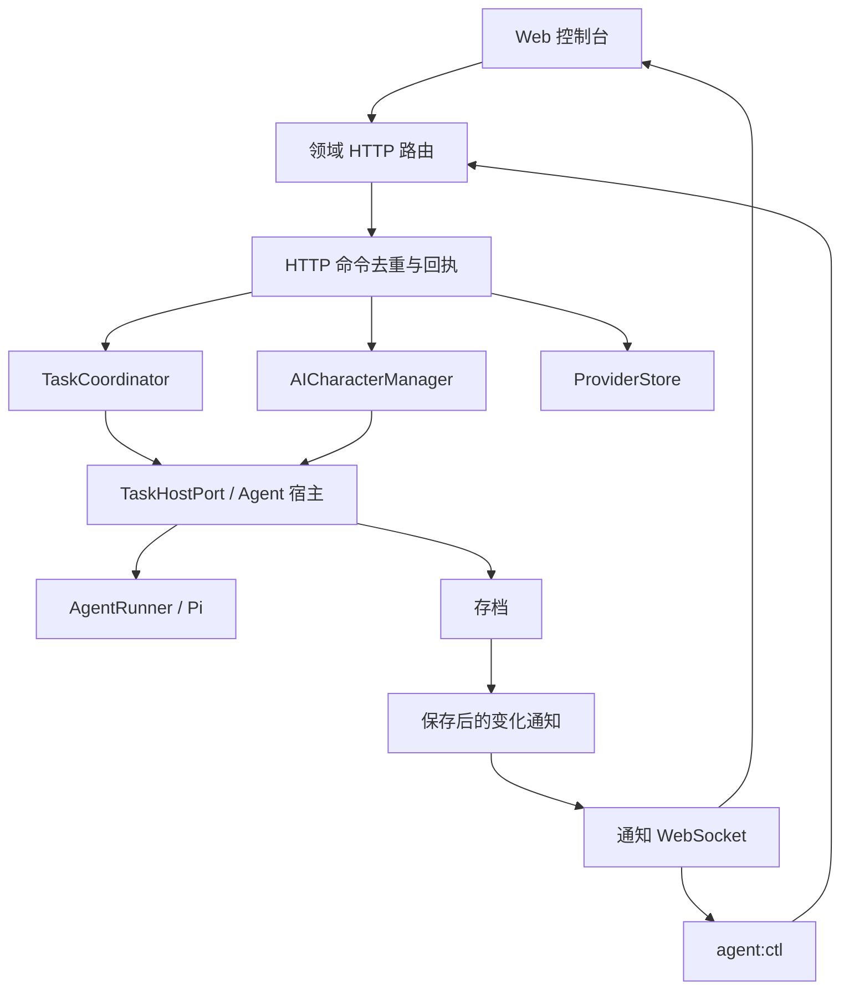

# Agent 管理接口

Web 与命令行共用领域 HTTP 接口。`/ai-characters/gateway` WebSocket 只发送状态变化通知，不再接收业务命令。管理连接与角色的 Colyseus 世界连接独立；关闭控制台或 CLI watch 不会停止托管角色，`stop` 才会让角色离开世界。



## 代码归属

- `packages/shared/src/management.ts`：管理公开视图、任务查询条件、命令回执和通知帧。通过 `@voxel/shared/management` 引用，避免与世界协议版本混淆。
- `packages/shared/src/management-client.ts`：浏览器和 Node 共用的 HTTP 请求、通知重连。通过 `@voxel/shared/management-client` 引用；没有业务 RPC 方法表。
- `apps/server/src/modules/gateway`：管理员令牌与通知 socket。没有另一套业务命令分发器。
- `apps/server/src/modules/management`：管理 HTTP 请求策略、错误映射、命令回执路由和资源变化通知。写命令使用同一份有界回执；`common/command-queue.ts` 只负责通用去重和串行执行，任务前置条件的回执策略由 `tasks/command-policy.ts` 提供。
- `apps/server/src/modules/ai-characters`、`tasks`、`providers`：各自的 HTTP 路由和业务规则。任务修订检查归属 Tasks。
- Tasks 路由直接使用 `TaskPort`，不再经过转发服务；世界聊天中的任务控制复用通用命令队列，HTTP 回执策略仍归 management。
- `apps/server/src/persistence`：联合存档格式、文件原子替换、迁移编排和一次提交后的可见性。角色快照与失败停止归属 `ai-characters/snapshots.ts`；任务快照、失败标记和历史任务迁移归属 `tasks/snapshots.ts`、`tasks/archive-migration.ts`。角色与任务仍共用一个存档和保存队列。
- `apps/server/src/openapi`：API 文档聚合与 schema；`/api-docs` 和 `/api-docs.json` 路径保持不变。角色模块不再转导出管理事件和联合存档，调用方直接使用其所属模块。
- `scripts/agent`：独立 AI 玩家、脚本机器人与管理 CLI。根目录 `pnpm agent`、`agent:ai`、`agent:mock`、`agent:ctl` 命令保留。
- `scripts/agent/config.ts`：独立 AI 玩家的环境变量解析。普通测试使用 `tests/support/agent-config.ts` 的独立配置，运行时只接收 `AgentConfig`。
- `apps/server/test/integration/world-client.ts`：原 CLI 集成检查，在随机端口和临时存档中运行。

## 授权和配置

优先读取 `AGENT_GATEWAY_TOKEN`。未设置时读取 `AGENT_GATEWAY_TOKEN_FILE`，默认 `.data/agent-gateway-token`；不存在则随机生成，文件权限 `0600`。启动日志只显示来源或文件位置。令牌为 24–4096 个无空白字符。更换后重启服务生效。

浏览器 Origin 必须在 `AGENT_GATEWAY_ALLOWED_ORIGINS` 逗号分隔列表中，禁止 `*`。未设置时使用明确的 `WEB_ORIGIN`；若游戏配置为通配，则仅使用固定本机开发 Origin。Docker 默认允许 `http://localhost` 与 `http://127.0.0.1`，其他域名和端口需显式配置。无 Origin 的 CLI 仍需令牌。

Web 首次进入控制台输入令牌，按服务地址保存在当前标签页的 sessionStorage，可以清除；认证失败停止重连。每个控制台共享一个 socket，切换分类不会创建新管理连接。断线保留最后数据、禁用写操作，重连后通过 HTTP 重新读取快照。Agent/任务不再通过两秒轮询刷新。

HTTP `/ai-characters`、`/providers`、`/tasks`、`/task-runs`、`/management`、`/voice/tts/**` 与 `/voice/asr/services` 管理接口要求 `Authorization: Bearer <token>`。ASR/TTS 配置仍用 HTTP；实际音频和游戏通道保持原有玩家会话授权。全局资源已从 `/ai-characters` 前缀迁出；前端与 HTTP 客户端须同步升级，业务参数和响应结构保持原样。

## HTTP 命令与通知

所有读写操作使用 HTTP：

| 功能                             | 入口                                                  |
| -------------------------------- | ----------------------------------------------------- |
| 角色列表、详情、创建、编辑、删除 | `/ai-characters`、`/ai-characters/:id`                |
| 角色上线、离线、语音配置         | `/ai-characters/:id/join`、`stop`、`voice`            |
| 模型服务管理                     | `/providers`                                          |
| 计划列表、创建、编辑、改派与控制 | `/tasks`、`/tasks/:planId` 及子路径                   |
| 执行历史与控制                   | `/tasks/:planId/runs`、`/task-runs/:runId/:operation` |
| 命令回执                         | `GET /management/commands/:commandId`                 |

角色快照包含 `resourceVersion` 和 `taskIdentity`。控制执行时可带 `expectedTask`（无任务为 null）；修改计划可带 `expectedPlanRevision`，不匹配返回 409。保留旧 HTTP 调用方省略前置条件的行为；管理 CLI 自动读取任务身份再提交控制操作。可选 `characterId` 校验绑定关系，不会将过期请求转向其他角色。

Web 和 CLI 自动给写请求附加 `Idempotency-Key`。同标识、同路径和业务内容的并发请求共享结果，改变业务内容返回 409；任务及计划修订字段作为首次执行的前置条件，不影响已提交命令的重试回执。角色创建等操作在存档完成后才返回成功。进程内保留最多 1024 个已完成回执、有效期 10 分钟；进程重启或过期后回执为 unknown。计划创建的 requestId 另外随存档持久化。

请求超时、取消或响应丢失可能发生在服务端提交之后。客户端不会自动重发写请求，会保留命令标识；Web 在状态同步时查询回执，CLI 可用 `receipt` 查询。成功提交不等于模型执行完成，进度以执行记录为准。

通知首帧为：

```json
{ "type": "connect", "version": 3, "token": "<管理员令牌>" }
```

服务端先回复 `connected`，再发送 `event: snapshot` 的刷新信号（data 为 null），客户端用 HTTP 读取所需资源。后续 `event: changed` 包含变化资源标识。每次连接的 seq 从 1 连续递增，丢失事件时断开重连并重新读取状态；重连不重放业务命令。先注册通知监听再发送刷新信号，避免快照读取期间漏掉变化。

5 秒内未握手会关闭连接，输入最多 32 KiB；发送积压超过 1 MiB 会关闭连接要求重新同步。认证失败停止重连。协议版本 3 只提供通知，不兼容旧 RPC v2 客户端；Web、CLI 与服务端需一起升级。原 CLI 的 `--url ws://.../ai-characters/gateway` 仍接受，并转换为同一服务的 HTTP 地址。

## CLI

```sh
pnpm agent:ctl auth show
pnpm agent:ctl list --json
pnpm agent:ctl status <characterId>
pnpm agent:ctl join <characterId>
pnpm agent:ctl stop <characterId>
pnpm agent:ctl task create <characterId> --goal '到指定位置等待'
pnpm agent:ctl run pause <runId> --character <characterId>
pnpm agent:ctl run resume <runId> --character <characterId>
pnpm agent:ctl run cancel <runId> --character <characterId>
pnpm agent:ctl plans [characterId]
pnpm agent:ctl runs <characterId> <planId>
pnpm agent:ctl watch <characterId>
pnpm agent:ctl receipt <commandId>
```

`--agent` 作为 `--character` 的兼容别名保留。即时任务创建后启动一次执行；恢复执行保留原 runId、进度和用量，不自动上线角色。计划暂停只停止后续调度，暂停当前执行使用 `run pause`。

所有管理命令支持 `--url`、`--token-file`、`--json`。默认地址 `http://127.0.0.1:2567`。令牌从环境变量或文件读取；`auth show` 显式读取本地令牌供页面配置。watch 的 Ctrl+C 只断开管理连接，独立 `agent:ai` 和 `agent:mock` 的 Ctrl+C 会退出其自身角色。

## 存档与部署

同一路径的存档升级为 v3 聚合对象：`{version:3, characters, plans, runs, requests}`。角色仅保存当前执行关联，计划与历史独立保存；任务身份仍为 v2，Pi 检查点为 v3。整个对象通过临时文件加原子替换一次提交，不存在第二份计划库。

首次加载旧角色数组前独占创建 `.before-task-plan-module-v1.bak`，已有备份不覆盖；备份、迁移或校验失败阻止升级写入。原计划/执行 ID、累计用量、检查点和按原角色作用域记录的 requestId 保留。纯聊天自动生成的计划转为无 planId 执行；混合或来源不明的历史保留，聊天执行不出现在计划历史。完成迁移和保存后才启动恢复与调度。

重启时未结束执行暂停，错过时间不补跑，未知动作不重放；私聊会话失效需重新通过聊天发起。消息队列和订阅不持久化。升级后的存档不能交给旧版写入；回滚必须先停服务，再恢复专用备份。现用服务备份、升级及重启是单独部署步骤。

存档失败会中断受影响 Agent 并停止其后续世界动作，命令不会返回提交成功；修复存储后重启。查询使用已提交快照。正常关闭停止接收写命令和调度，取消执行、等待退出、保存暂停状态、关闭连接；保留原上线意愿以便下次上线待命。

Nginx 代理覆盖 `/ai-characters`、`/providers`、`/tasks`、`/task-runs`、`/management`、`/voice`；`/ai-characters/gateway` 保留 Upgrade；同一分发器区分 Gateway、实时 ASR 和 Colyseus。Dockerfile 使用现有 shared 和 agent-runtime 工作区，未增加部署端口或容器。升级切换现用服务属于单独部署步骤。

## 验证入口

`pnpm check` 检查全仓 lint、类型、单元回归和构建。`pnpm test:gateway` 验证真实 HTTP/通知 WebSocket、鉴权、命令回执、任务修订、独立计划、断线后托管继续和 CLI 退出；`pnpm test:integration` 验证世界协议。两项集成使用随机端口和临时存档，不修改本地开发世界。真实模型、浏览器和 Docker 验证分别记录，fixture 测试不代替真实模型验收。

本次不修改存档格式、管理员令牌环境变量、文件路径和浏览器会话键。
