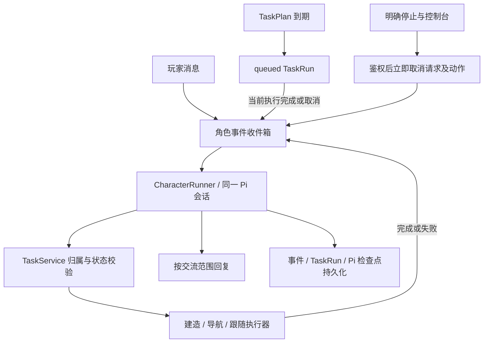

# AI 角色统一事件运行时

聊天、计划到期和动作结果使用同一个 `CharacterRunner` 和 Pi 工具循环。Pi 负责理解意图、选择工具；程序负责鉴权、排队、动作推进、预算和持久化。

## 事件和执行

每个角色只有一个模型执行槽。角色在线期间复用 Pi Agent，切换事件时替换输入与授权上下文。`TaskPlan` 是触发规则；`TaskRun` 是执行记录，不另建活动任务库。

事件包含去重 ID、种类、交流范围、发起者和相关计划、执行、动作身份。聊天先持久化后进入内存消息队列。事件审计保留未处理项和最近 64 条已处理记录；待执行计划由持久化 TaskRun 保证恢复。计划按 ID、修订和到期时间去重；周期计划最多保留一个 queued 项并累计合并次数。

queued 项没有运行时任务和用量；按首次到期时间启动。暂停、受阻、额度耗尽、等待人工输入都保留当前执行，不会启动下一项。完成或取消释放执行槽。修改计划仅影响后续触发；显式暂停、归档、重新指派取消旧待执行项并保存原因。离线或停机期间的到期触发不补跑。

## 工具、上下文与权限

所有事件使用同一套 `reply`、任务控制、观察及世界工具。聊天开始任务后可直接调用世界工具，无第二次模型交接。`TaskService` 校验任务发起者、私聊接收者、任务 ID 和修订；模型输出不能授予权限。

当前任务保留结构化进度。公共交流和每个私聊对象分别保留最近 8 组完整交互，包括用户输入和工具结果；最多保留 16 个私聊范围。裁剪不留下孤立工具结果。不同玩家看不到私有任务内容，也不能修改他人的任务。

问进度使用 `reply`，不重建任务。改目标使用 `revise_task`；切换工作使用 `cancel_task` 后 `start_task`，先等待旧动作停止。新任务不继承旧任务的额度用量；触发切换的请求仍记入原活动，之后请求计入新活动，角色累计不清零。

## 持续动作

`build`、`house`、`goto` 返回动作 ID，执行器异步推进；完成结果绑定原任务身份和修订。动作进行期间可回答消息，每个角色最多一个冲突动作。普通进度不调用模型，迟到结果不能推进新任务。

建造复用蓝图和逐块确认；跟随复用本地导航循环，每次推进有时限且不请求模型。暂停保留蓝图和跟随意图。停止先鉴权，取消请求和动作，等待停止，再提交状态。完成判定依赖实际观察；未知效果不得自动重放。

## 额度

角色默认额度为 100 次模型请求、50,000 tokens、15 分钟。计划默认继承，也可覆盖；实际开始时保存快照。修改角色设置不修改已启动的执行。继续操作提交新的总额度，保留 ID、进度及已用量。

每次实际模型请求独立检查、计量和取消。独立问答使用角色默认额度的事件预算；升级为任务时将已发生用量转入一次。与当前工作相关的回答通过 `chat.relatedToTask`（或 `reply`） 归属当前活动；额度耗尽时状态问答仍可回答，但世界工具不能绕过任务限制。执行时间统计模型与动作活跃时间，并行区间不重复计算；排队和人工暂停不计时。

## 存档、恢复和回退

宿主聚合存档升级为 v3，Pi 检查点为 v3，事件队列为 v1。读取旧档前生成 `.before-character-events-v3.bak`，原子替换保存。旧计划明确额度标记为 override，角色、计划、执行 ID、进度、用量和历史保留。

重启后正在执行的任务暂停，执行中动作标记 unknown。私聊接收者会话失效时保持待处理，私聊历史不转为公共历史。已持久化 queued 项保留；旧聊天事件不自动重发。保存失败停止后续写操作。

回退时先停止服务，恢复匹配版本的代码及备份，再启动；不能用旧代码直接写新版存档。不要删除现有世界或数据库卷。

## 验证

- `pnpm check`：类型、单元测试、生产构建。
- `pnpm test:agent:tasks`、`pnpm test:agents`、`pnpm test:gateway`、`pnpm test:navigation`：临时隔离世界。
- `pnpm --filter @voxel/server exec tsx test/integration/character-events-live.ts`：默认使用本机 Ollama qwen3:8b，在临时世界验证聊天建造、计划建造、持续跟随、期间问答和立即停止。最多 24 次真实请求，结果保存到 `output/unified-events/live-model.json`。可通过 EVENTS_MODEL / EVENTS_MODEL_URL 指定本机模型；不读取用户服务密钥。
- Docker 构建与浏览器验收分别记录，不能用单元测试代替。任何写世界的测试必须指定隔离实例，不使用当前用户世界。
