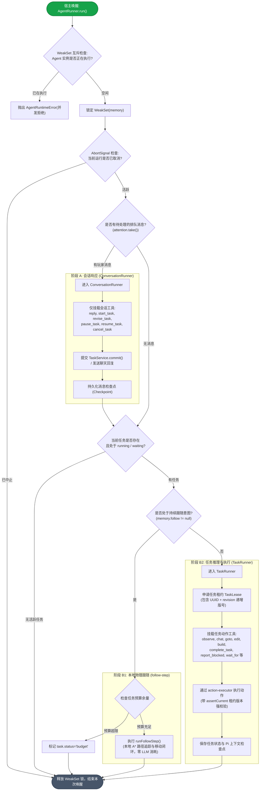
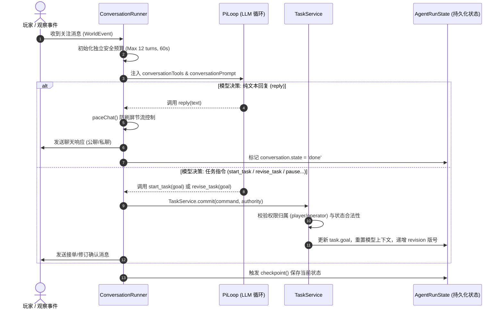
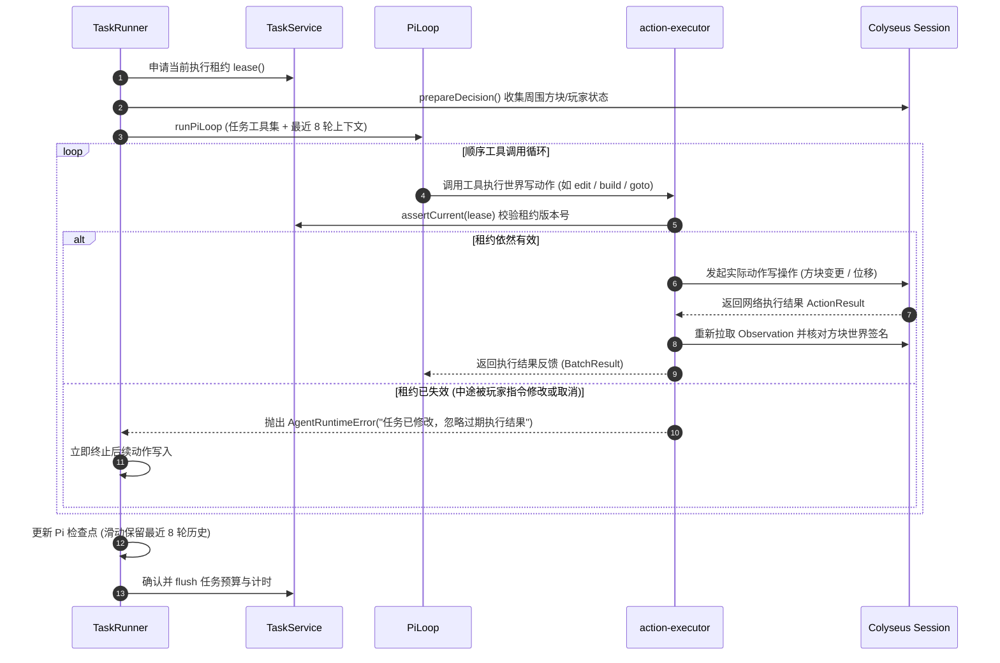
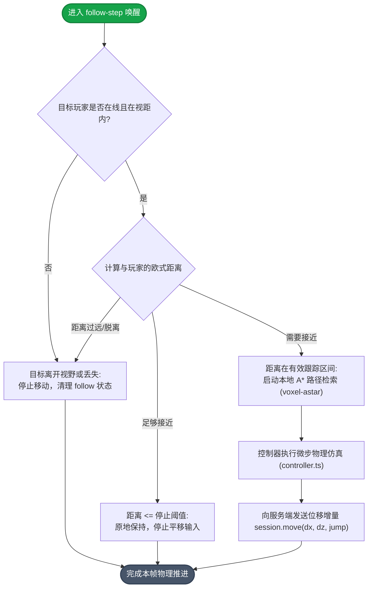

# Agent Runtime 架构与执行流程设计文档

托管角色的入口与调度由 [Agent Gateway](AGENT_GATEWAY.md) 负责；本包继续负责对话、任务、动作和结果验证，独立 CLI 仍可直接使用。

`@voxel/agent-runtime` 为服务端托管 Agent 与命令行 CLI 提供统一的 Pi 智能体执行内核。其核心设计遵循**双循环隔离**、**乐观并发与租约控制（Lease）**、**零成本物理跟随**以及**严格分级预算与持久化熔断**机制。

---

## 1. 架构总览与分层设计

包内遵循严格的单向依赖规则，禁止循环依赖与反向引用：

```mermaid
graph TD
    classDef runtime fill:#2563eb,stroke:#1d4ed8,stroke-width:2px,color:#fff;
    classDef pi fill:#7c3aed,stroke:#6d28d9,stroke-width:2px,color:#fff;
    classDef task fill:#059669,stroke:#047857,stroke-width:2px,color:#fff;
    classDef act fill:#d97706,stroke:#b45309,stroke-width:2px,color:#fff;
    classDef client fill:#475569,stroke:#334155,stroke-width:2px,color:#fff;
    classDef model fill:#db2777,stroke:#be185d,stroke-width:2px,color:#fff;

    subgraph RuntimeLayer["Runtime 编排层 (packages/agent-runtime/src/runtime)"]
        AR["AgentRunner / AgentCoordinator"]:::runtime
        CR["ConversationRunner<br/>(消息会话与指令解释)"]:::runtime
        TR["TaskRunner<br/>(任务模型循环与动作决策)"]:::runtime
        FS["follow-step<br/>(本地物理跟随闭环)"]:::runtime
        AE["action-executor<br/>(世界动作防迟到守卫)"]:::runtime
        PL["pi-loop<br/>(通用底层工具循环)"]:::runtime
    end

    subgraph PiLayer["Pi 交互适配层 (packages/agent-runtime/src/pi)"]
        PP["Prompts 提示词体系"]:::pi
        CT["Conversation Tools<br/>(reply / start / revise 等)"]:::pi
        TT["Task Tools<br/>(goto / edit / build / complete 等)"]:::pi
        CP["Checkpoint 快照管理"]:::pi
    end

    subgraph TaskLayer["Task 业务域层 (packages/agent-runtime/src/task)"]
        TS["TaskService<br/>(租约管理 / 状态机 / 归属校验)"]:::task
        RB["RequestBudget<br/>(调用次数 / Token / 超时预算)"]:::task
        TO["Observation & Signature<br/>(世界签名与核对)"]:::task
    end

    subgraph ActionLayer["Actions 动作执行层 (packages/agent-runtime/src/actions)"]
        NA["Navigation<br/>(LocalMap / A* / 运动控制)"]:::act
        BA["Building<br/>(建造计划 / 批量放置 / 恢复)"]:::act
        EX["Action Parser & Execute"]:::act
    end

    subgraph ModelLayer["Models 模型层 (packages/agent-runtime/src/models)"]
        MC["Model Catalog & Pi Adapter"]:::model
        RA["RequestAccounting<br/>(用量统计与流式熔断)"]:::model
    end

    subgraph ClientLayer["Client 连接层 (packages/agent-runtime/src/client)"]
        SS["Colyseus AgentSession<br/>(观察订阅 / 物理移动 / 动作 RPC)"]:::client
    end

    AR --> CR
    AR --> TR
    AR --> FS

    CR --> CT
    CR --> TS
    CR --> PL

    TR --> TT
    TR --> TS
    TR --> AE
    TR --> PL

    PL --> MC
    PL --> RA
    AE --> BA
    AE --> NA
    AE --> SS
    FS --> NA
    FS --> SS
```

### 分层职责矩阵

| 模块目录                                                                       | 核心职责                                            | 明确不负责事项                   |
| :----------------------------------------------------------------------------- | :-------------------------------------------------- | :------------------------------- |
| [`packages/agent-runtime/src/runtime/`](../packages/agent-runtime/src/runtime) | 串联协调调度、并发互斥、消息唤醒、分发执行          | 服务端 HTTP 接口、数据库直接操作 |
| [`packages/agent-runtime/src/task/`](../packages/agent-runtime/src/task)       | 任务状态机、Lease 租约、权限归属校验、预算统计      | 模型请求发起、世界直接写入       |
| [`packages/agent-runtime/src/pi/`](../packages/agent-runtime/src/pi)           | 提示词构造、Tool 映射规范、会话上下文管理、检查点   | 调度时钟、物理位移控制           |
| [`packages/agent-runtime/src/actions/`](../packages/agent-runtime/src/actions) | 物理移动、方块批量放置/破坏、A\* 寻路计算与闭环跟随 | 任务状态转换、模型调用           |
| [`packages/agent-runtime/src/models/`](../packages/agent-runtime/src/models)   | 模型接口适配、流式生成处理、请求级计费与取消        | 业务逻辑、工具执行               |
| [`packages/agent-runtime/src/client/`](../packages/agent-runtime/src/client)   | Colyseus 网络连接、状态观察订阅、世界写请求         | 任务逻辑、决策生成               |

---

## 2. 调度执行全景主流程

外部驱动（服务端心跳调度器或 CLI）调用 `AgentRunner.run()`。`AgentCoordinator` 负责保证单 Agent 的串行原子执行：

---

## 3. 核心机制详细序列

### 3.1 消息处理与任务状态机流（ConversationRunner）

- **职责边界**：仅理解玩家发来的聊天，负责礼貌回复或转换为任务指令；**禁止直接发起世界动作（如移动、放置方块）**。
- **独立预算安全罩**：最多 12 次请求、50,000 Token、60 秒超时，纯聊天用量不计入建筑任务。

---

### 3.2 任务决策与动作执行流（TaskRunner & ActionExecutor）

- **乐观并发与 Lease 机制**：每个任务执行段持有 `TaskLease { id, revision, startedAt }`。
- **防迟到机制**：若在长耗时的动作执行或模型调用期间，玩家插话并修改（`revise_task`）或取消了任务，旧任务的迟到结果在提交世界前会被 `service.assertCurrent(lease)` 拦截并丢弃。

---

### 3.3 零成本本地物理跟随（follow-step）

当 Agent 处于跟随玩家状态时，不消耗 LLM Token，直接在宿主循环中通过本地导航推进：

---

## 4. 关键设计模式总结

1. **双循环上下文隔离（Dual Loop Context Isolation）**
   - 聊天会话循环与建造任务循环拥有独立的提示词、工具集和记忆队列；
   - 玩家的问候、闲聊绝不进入任务的最近 8 轮工具执行上下文，避免消耗任务 Token 和稀释模型注意力。
2. **基于 Revision 的租约保护（Lease Protection）**
   - 任何改写任务（`revise` / `cancel`）都会重置 `revision`；
   - 正在执行的异步网络请求与批量方块放置，在写操作前必须验证租约，防止“旧任务动作破坏新任务场景”。
3. **分级预算与持久化熔断（Budget & Persistence Circuit Breaker）**
   - 每一轮会话和任务都有严格的调用次数、Token 上限和耗时限制；
   - 若持久化操作（`checkpoint()`）发生异常，执行器立即熔断写操作，避免状态与世界不同步。
