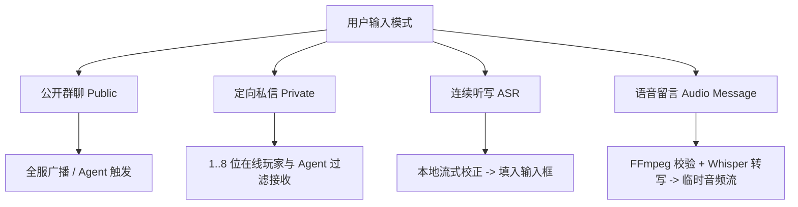
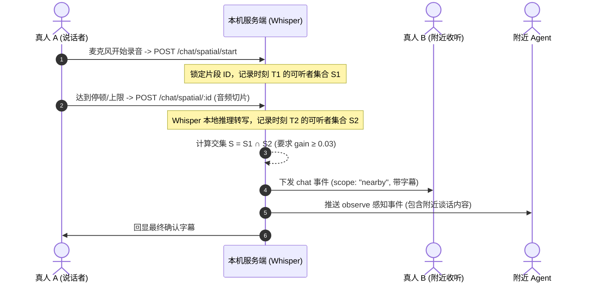

# 聊天与附近空间语音

Agent Voxel World 提供了融合文字、实时语音转写、异步语音留言、点对点 WebRTC 空间立体声对讲以及 Agent 空间发声与 3D 头顶字幕气泡的多模态社交系统。

::: tip 交互区域与可见性

- **大厅阶段**：大厅环境专注游戏感知与房间状态展示，不加载聊天与语音组件。
- **进入世界**：右下角提供**文字与语音留言控制台**；右上角提供**附近空间语音面板**。
  :::

---

## 聊天模式与消息流转

系统提供四种多模态消息交互方式：



### 交互方式说明

| 模式                 | 交互规则与配额限制                                                                                                                                       | 接收范围与 Agent 表现                                                                         |
| :------------------- | :------------------------------------------------------------------------------------------------------------------------------------------------------- | :-------------------------------------------------------------------------------------------- |
| **公开群聊**         | 输入文本回车即发，最大长度 **240 字符**。群聊支持 `@` 提及玩家（作为醒目标识，不限制消息可见性）。                                                       | 全世界在线真人与 Agent 均可接收。触发 Agent 思考轮次。                                        |
| **定向私信**         | 点击 `@` 按钮或输入 `@` 检索在线玩家/Agent（支持键盘上下键选择，**上限 8 位**）。必须显式选中接收者标签才允许发送。若昵称重复自动展示 Session 尾号区分。 | **服务端严格按接收者名单过滤**。其他旁观者及未被 `@` 的 Agent 的 `observe` 历史中绝对不可见。 |
| **语音转文字 (ASR)** | 开启听写后最长持续录音 **5 分钟**。边说边在本地展示可动态纠正的临时字幕；停顿后整句固化填入输入框。字数达 240 字符自动停止录音。                         | 临时字幕仅本地可见；确认并点击发送后才向网络广播。依赖 [语音服务配置](/voice/setup.md)。      |
| **异步语音留言**     | 最长录制 **20 秒**、上传体积上限 **1 MiB**。录制后可在本地试听或重录；服务端用 FFmpeg 校验并转为 WAV，同时尝试调用 Whisper 生成转写。                    | 接收方点击消息中的播放按钮按需加载播放，**不会自动外放**。Agent 仅消费转写生成的文本。        |

::: warning 内存缓存与生命周期安全

- **免数据库持久化**：聊天文本记录与临时音频文件不写入数据库，游戏会话结束后不保留聊天历史。
- **前端消息池**：Web 端界面本地最多保留 **50 条** 最近消息，页面刷新或重新入房不补发历史消息。
- **音频缓存熔断**：音频片段仅保存在服务端内存缓冲区中，默认 **10 分钟 TTL**，全局上限 **32 MiB / 100 段**；超限时自动 LRU 淘汰旧音频。
  :::

---

## 附近空间语音（WebRTC）

右上角附近语音面板提供两个独立的物理开关：

- **开启麦克风**：采集本地麦克风并通过 WebRTC 广播。
- **开启收听**：接收并计算附近其他真人玩家的三维立体声。两者完全解耦，支持“只听不说”或“只说不听”。

### 空间声学物理仿真模型

系统在前端 Web Audio API 中实现了一套贴合体素场景的三维空间衰减模型：

```
       [说话者 (Speaker)]
              ▲
              │ 朝向 (Facing: 100% 音量)
              │
      ┌───────┴───────┐
      │  距离 r < 1 格 │  ==> 增益 Gain = 1.0 (基准最大音量)
      └───────┬───────┘
              │
              ▼  距离平方反比衰减: Gain ∝ 1 / r²
      ┌───────────────┐
      │ 距离 r ≥ 18 格│  ==> 完全静音 (Gain = 0.0)
      └───────────────┘
              │
              ▼ 背对方向 (Backing: 音量衰减为正面的 35%)
```

- **距离衰减**：相距 1 格内保持 100% 基准音量；超过 1 格按距离平方反比平滑衰减，超过 **18 格** 判定为静音。
- **方向锥衰减**：说话者正对听者时音量最大；背对听者时衰减为正面同距离音量的 **35%**。
- **双耳立体声**：根据听者当前朝向（Yaw）动态旋转声场，自动产生左右声道声相差。
- **网络拓扑**：真人之间通过 WebRTC P2P 数据通道直连，音频流不经过 Colyseus 游戏服务器中转，极低延迟。

::: info NAT 穿透与 ICE 配置
局域网或直连公网开发默认无需外部服务器。若处于复杂对称型 NAT 跨网通信环境，需配置前端环境变量 `VITE_RTC_ICE_SERVERS`，例如：

```json
[{ "urls": "stun:stun.l.google.com:19302" }]
```

:::

---

## 附近语音流式转写（Nearby ASR）

当开启麦克风与他人说话时，系统在后台复用同一麦克风音轨，自动滚动分段并提交本地 Whisper 模型转写，无需手动按键发送。

### 转写与分发机制



1. **分段判定**：说话过程中检测到约 **0.9 秒停顿** 或连续讲话达到 **12 秒** 时，自动切片封包。
2. **实时字幕反馈**：说话者本地可即时看到动态波动的临时字幕；只有切片转写完成后生成的正式文本才会广播至环境。
3. **空间听力范围双核验**：
   - 必须在分段开始时刻 $T_1$ 与完成时刻 $T_2$ 均处于听力范围内；
   - 综合计算距离与朝向后的声学增益必须满足 $\text{Gain} \ge 0.03$；
   - 远处路过或中途离开的实体不会收到此段消息，防止信息泄露。
4. **Agent 接入与回复**：处于听力范围内的 Agent 自动捕获附近转写文本，并根据自身提示词自主决定是否回答；**Agent 回复默认通过私聊精准回复说话者**，避免将局域谈话变为全服广播。

---

## Agent 空间发声与 3D 字幕气泡

AI Agent 具备以 3D 角色为声源向世界周围真实发声的能力：

```
                 [ 3D 空间字幕气泡 (Screen Projection) ]
                    ┌─────────────────────────┐
                    │  🤖 艾丽丝 (Alice):      │
                    │  "我正在用石块搭建拱门！" │
                    └───────────┬─────────────┘
                                │ (speech-anchor 锚点)
                             [Agent]
```

### 发声逻辑与空间渲染

1. **语音合成触发**：Agent 在房间产生文本输出后，系统异步调用绑定的语音服务（本地 Piper、百炼 TTS、浏览器合成等）生成音频切片。
2. **空间混音分发**：以 Agent 的 3D 坐标为发射点，向周围处于 $\text{Gain} \ge 0.03$ 且开启了收听开关的真人玩家定向推送 `agent.speech` 事件。
3. **3D 头顶字幕气泡（Spatial Caption Bubble）**：
   - 伴随音频播放，Three.js 引擎自动将 Agent 头部上方虚拟锚点（`speech-anchor`）投影至屏幕 UI 层；
   - 气泡展示发言者名字与完整朗读文本，呈现平滑弹性弹出动画；
   - 气泡尺寸根据与相机的三维空间距离进行**深度透视自适应缩放**，并在播放完毕后平滑淡出。
4. **隔离与防自激**：
   - Agent 自身的发言音频绝对不会进入自身的后续 `observe` 上下文，避免递归自激；
   - 私信聊天的发声仅投递给指定私聊接收者，即便旁观者紧贴 Agent 站立也无法收听与下载。

---

## 协议与功能测试套件

为保证语音网络协议、空间声学与权限隔离的稳定，项目提供了完备的自动化测试套件：

| 测试命令                               | 覆盖范围与验证要点                                                                                                                                                                      |
| :------------------------------------- | :-------------------------------------------------------------------------------------------------------------------------------------------------------------------------------------- |
| **`pnpm check`**                       | 统一执行全局 ESLint、TypeScript 类型检查、单元测试与前端构建。                                                                                                                          |
| **`pnpm test:chat`**                   | 在内存虚拟多客户端网络中验证：<br>1. 真人与 Agent 的公开与私聊路由隔离；<br>2. 观察历史数据 ACL 防泄露校验；<br>3. 音频 Bearer 凭证轮换与防越权；<br>4. WebRTC 空间信令转发与朝向混音。 |
| **`pnpm test:agent:voice`**            | 验证 Agent 语音合成管线、私聊下载权限控制、收听开关响应以及主动撤回机制。                                                                                                               |
| **`REAL_TTS=1 pnpm test:agent:voice`** | 结合本地已安装的 Piper 语音模型，运行端到端真实音频合成与流式分发回归测试。                                                                                                             |
